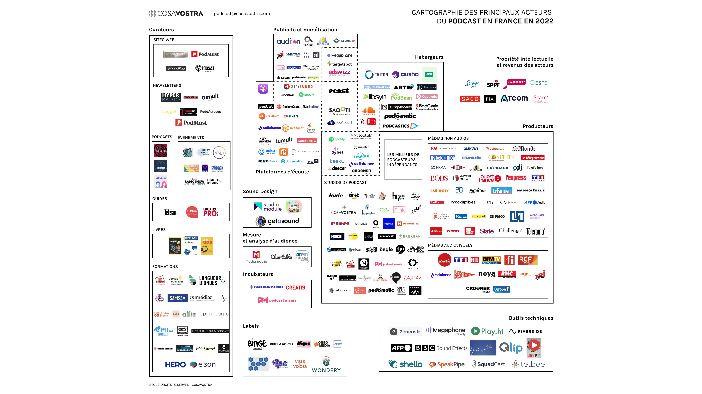
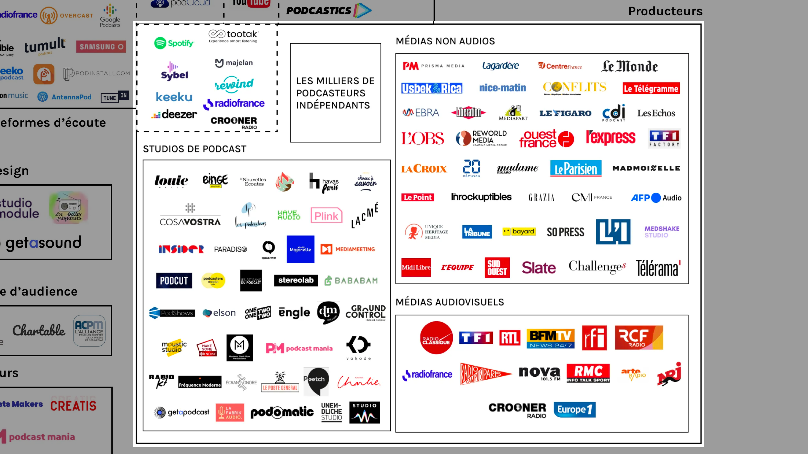
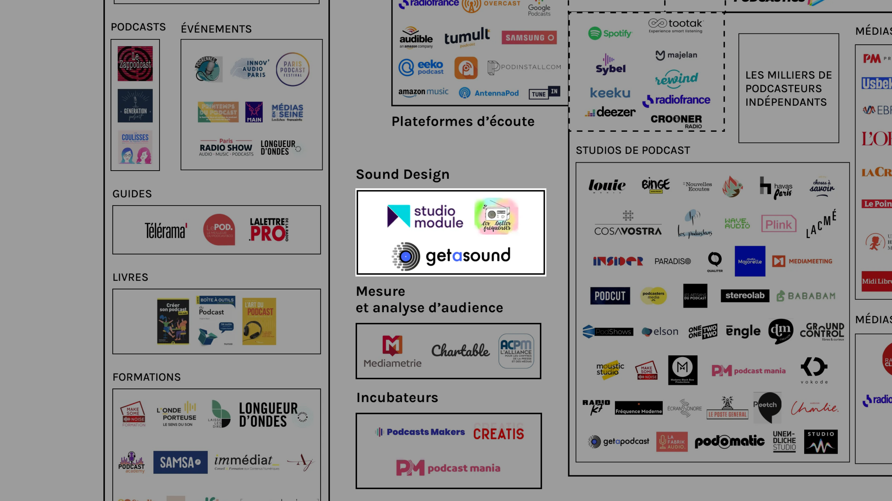
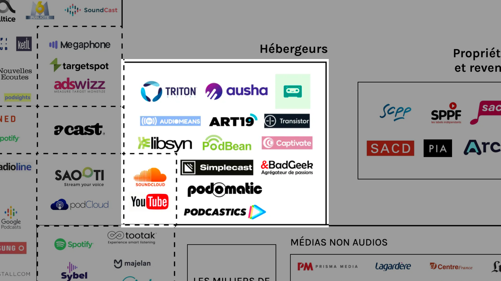
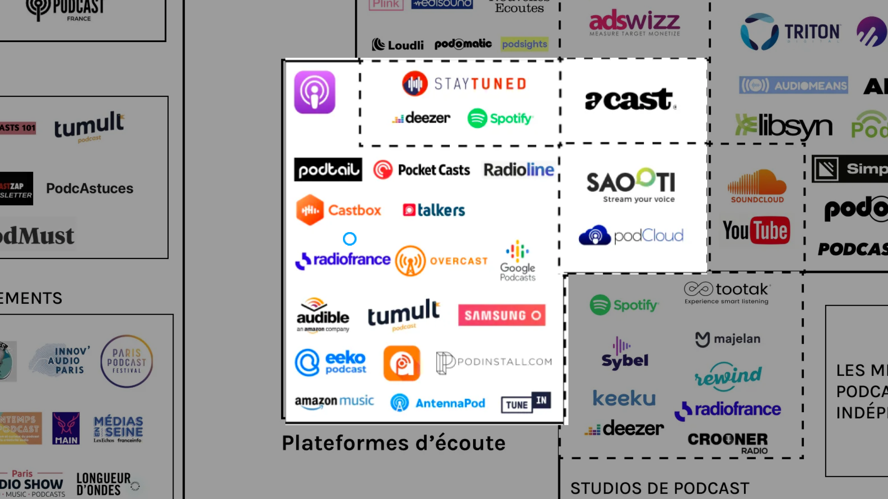
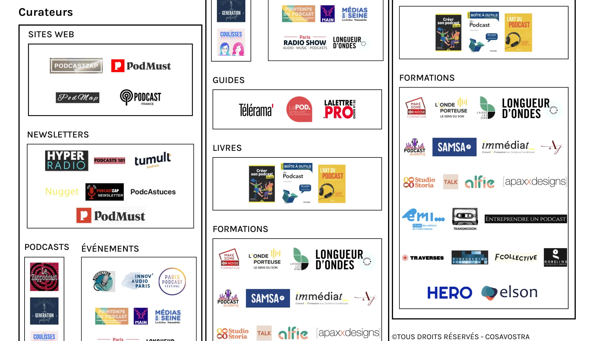

<!-- _class: image-full -->

---

<!-- _class: image-full -->

---

<!-- _class: image-full -->

---

<!-- _class: image-full -->

---

<!-- _class: image-full -->

---

<!-- _class: image-full -->

---

## À retenir

- **Des frontières poreuses** : un même acteur peut produire, héberger et diffuser

- **Produire** : studios, radios, médias, marques ou indépendants

- **Diffuser** : un hébergeur pour stocker le podcast, des plateformes pour le faire écouter

- **Structurer et financer** : curateurs, régies publicitaires, mesure d'audience et droits d'auteur
