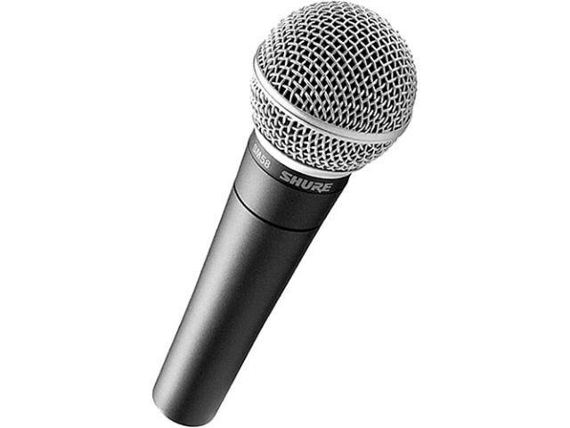
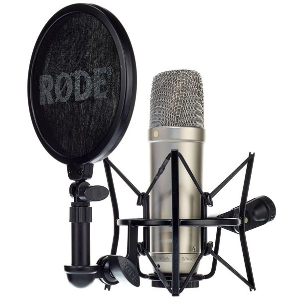

## Un bon montage ne sauve pas une mauvaise prise

- Ce qui est mal enregistré reste mal enregistré

- Quatre leviers au moment de la prise : **le micro**, **la pièce**, **la distance**, **les niveaux**

---

<!-- _class: columns-2 -->

## Le micro

### Dynamique

Robuste, peu sensible, capte surtout ce qui est proche. Idéal dans une pièce non traitée ou en extérieur.

### Statique

Plus précis, plus sensible, capte aussi la pièce et ses défauts. Demande un lieu calme.

---

## La pièce s’entend autant que la voix

- Chercher un lieu **calme** et **mat** : rideaux, canapé, livres

- Fuir les surfaces dures : carrelage, vitres, murs nus

- Couper ce qui ronronne : frigo, ventilation, notifications

---

## Distance et position

- Une main à une main et demie entre la bouche et le micro, et ne plus en bouger

- Parler **légèrement à côté** pour éviter les plosives, ou utiliser un filtre anti-pop

- En interview : un micro par voix, à la même distance

---

## Les niveaux

- La voix culmine autour de **-12 dB**

- Une saturation est **irrécupérable** au montage

- Enregistrer en **WAV**, 48 kHz, 24 bits. Le MP3, c’est pour la diffusion

---

## Les bons réflexes

- **Toujours au casque**

- Un **test** de quelques secondes, réécouté, avant la vraie prise

- **30 secondes de silence** de la pièce, pour boucher les trous au montage

- Sur le terrain : des **sons seuls** et des **ambiances**

---

<!-- _class: statement -->

> Le casque ne ment pas : ce qu’on y entend, c’est ce que l’auditeur entendra

---

## Enregistrer à distance

- **Riverside** : chaque participant est enregistré en local, sur son ordinateur

- Pas de coupures, pas de son compressé comme dans un appel en ligne
